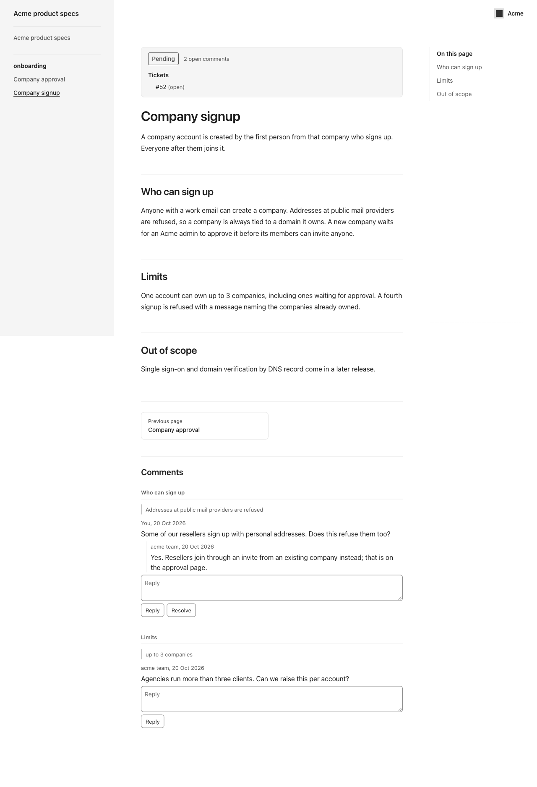
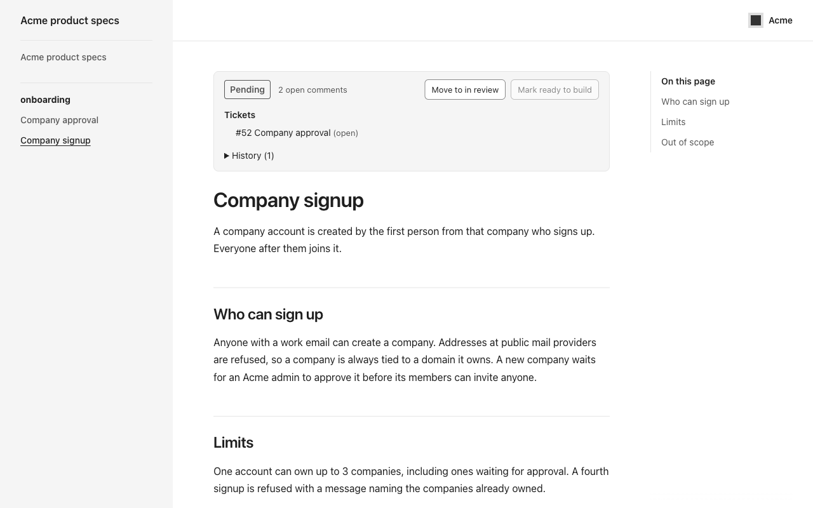
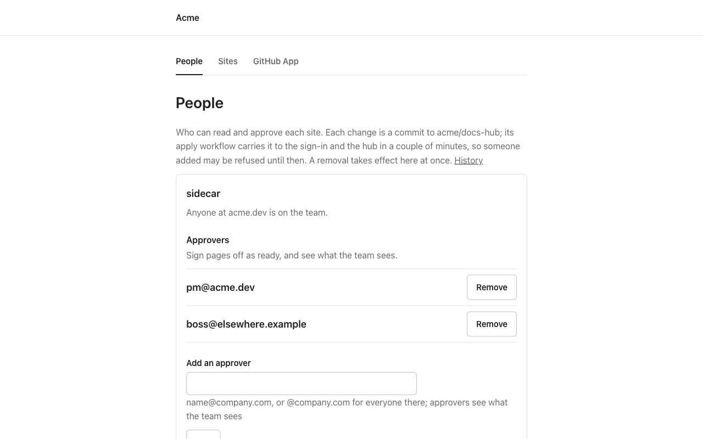

# specreview

Review specs where they are rendered. A team keeps its specs as Markdown in each repo's `docs/` folder. specreview builds each repo's docs into a site and serves every site from one hub that the team hosts on its own Cloudflare account and domain. Readers select text on a page and comment on it, product marks a page ready to build, and that status shows on the GitHub issues the page links as a label.

## Status

Early. Releases are tags on `main`, `v0.4.0` the newest ([releases](https://github.com/jadedm/specreview/releases)). One organisation runs a hub in production. To run one, pin the commit a release tag points to in your hub repo's `specreview.commit` (`gh api repos/jadedm/specreview/commits/v0.4.0 --jq .sha` gives it). The plan and its order are on issue #1.

Built and tested:

- The hub (`packages/hub`): serving sites, comments and replies, page status, ticket labels, who may see what; an index page of the sites a person may read; public sites, readable without signing in, per site; the organisation's name and logo in each site's header.
- The admin page (on its own hostname, apart from the docs sites, for the config's admins): creates the organisation's GitHub App from a manifest and keeps its key in the hub's database, encrypted; adds a site by opening the pull requests it needs; edits each site's readers and approvers as commits to the organisation's config repo, with a removal taking effect at once.
- The site build (`packages/site`): turns a repo's committed `docs/` into a site with the review UI, plus every page's earlier versions for the team to compare.
- Publishing (`build/` and `publish/` actions): a GitHub Actions workflow builds the site and uploads it to the hub, authenticated by GitHub's own OIDC token, so a product repo holds no secret.
- Running a hub (`examples/org/`, `packages/hub/deploy/`): the template for the organisation's private config repo. A first install from a laptop creates the Cloudflare resources and Access applications and deploys the Worker; after that, the repo's apply workflow applies every push to `main`, with a Cloudflare token that `workflow-token` creates, limited to the permissions a run needs (its reach is in the template's README).

Not built yet:

- A guided setup command (#7). Today an organisation copies `examples/org/` and follows its README.

## See it

A reader selects text on a page and comments on it. They see the team's replies, labelled with the team's name rather than anyone's email, and each linked ticket's status:



An approver sees the same page with the controls to move it to in review and to mark it ready to build. The status shows on the linked GitHub issues as a label:



The hub's own address lists the sites a person may read:


The admin page, on its own hostname, manages who reads and approves each site, adds sites and sets up the GitHub App:



To try it on your machine (Node 22.13 or later and pnpm 10), build, publish this repo's test docs to a local hub, and sign in as one of its sample people. The test docs are a set of feature pages rather than the specs above, and there are no comments until you add some:

```
pnpm install --frozen-lockfile && pnpm build
OUT=$(packages/site/scripts/smoke-fixture.sh)
SMOKE_SITE=$OUT node packages/hub/scripts/smoke-server.mjs
```

Then open `http://127.0.0.1:8796/__smoke/login?email=riya@initech.example` to read as a reader, or `email=pm@acme.dev` as an approver, and `http://admin.localhost:8796/__smoke/login?email=owner@acme.dev` for the admin page. The local hub stands in for Cloudflare Access and GitHub and calls nothing outside your machine.

## How it fits together

- **One hub per organisation.** A Cloudflare Worker with one D1 database (comments, status, the admin page's records) and one R2 bucket (built sites), behind one Cloudflare Access application on the organisation's own domain. Each repo is a site at `/<repo>/`. Organisations are kept apart by being separate deployments.
- **Who sees what.** Cloudflare Access signs people in. Someone at one of a site's team domains is team; listed approvers can mark pages ready; listed readers (an exact email or a whole domain) can read and comment. Readers never see other people's email addresses or ticket titles. The lists live in the organisation's config file; the admin page changes them by committing to it.
- **Publishing.** On a push to the docs branch, the product repo's workflow runs the `build` action, then the `publish` action uploads the build to `POST /_publish/<repo>`. The hub accepts it only from that repository's configured workflow and branch, checks the build whole, and makes its pages live together by moving one pointer; earlier page versions are written just after. `examples/publish-docs.yml` is the workflow to copy, and the admin page writes it into a new site's repo.
- **The site build keeps code out of Markdown.** It refuses scripts and styles in pages, includes, symlinks, and front matter other than `title`, `order` and `issues`, and strips any rendered HTML outside an allowlist, so approving a docs pull request never means reading it for code. The hub does not re-check what a build contains: anyone who can push to a site's configured branch can change its workflow and publish anything, so treat that access as access to every site on the hub.
- **GitHub.** The hub reads tickets and sets labels as the organisation's GitHub App, with a token per repository and purpose. The same app opens the pull requests and commits the admin page makes.

## Run a hub

`examples/org/README.md` is the guide: a Cloudflare account with Zero Trust on its free plan, a zone for the hub's hostname, and a private GitHub repo made from `examples/org/`.

## Packages

| Package           | What it is                                                                      |
| ----------------- | ------------------------------------------------------------------------------- |
| `packages/hub`    | The Cloudflare Worker an organisation deploys                                   |
| `packages/site`   | `specreview-site build`: the VitePress setup, review UI and manifest for a repo |
| `packages/shared` | Text rules and manifest checks used by both the hub and the site build          |
| `packages/action` | The uploader behind the `publish` action, bundled into `publish/dist/`          |
| `packages/cli`    | `@jadedm/specreview`, the setup command (#7); a placeholder for now             |

## Development

Node 22.13 or later and pnpm 10.

```
pnpm install --frozen-lockfile
pnpm lint:check
pnpm format:check
pnpm check:packages
pnpm typecheck
pnpm test
pnpm build
```

The hub's tests run inside workerd, the Workers runtime, with a local D1 database. `CONTRIBUTING.md` says how to propose a change and run the local smoke tests; `CLAUDE.md` holds the maintainers' detailed notes on each part.

## Security

Report vulnerabilities privately; see `SECURITY.md`.

## Licence

- `packages/hub`, the Cloudflare Worker that serves sites and runs review, is licensed under the GNU Affero General Public License v3.0 only (`packages/hub/LICENSE`). If you run a modified hub as a service, you must offer its source to the people who use it.
- Everything else (the publish action, the CLI, the site build and the shared package) is MIT (`LICENSE`), so product repositories can use them freely.
