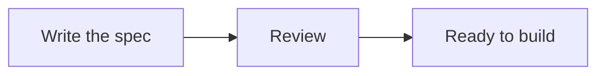
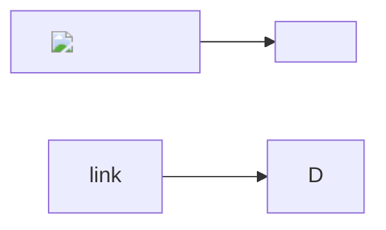
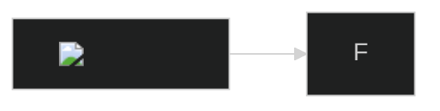
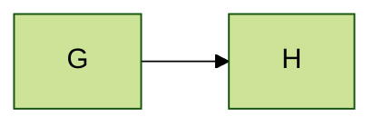
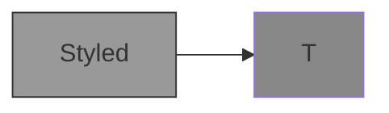
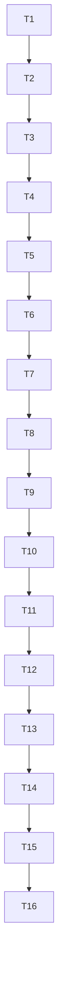

# Diagrams

## Flow

The paragraph before the diagram.



The paragraph after the diagram.

## Broken

```mermaid
flowchart LR
  A --> -->
```

Text after the broken diagram.

## Hostile labels



## Directive



## Front matter



## Styled



## Wide

```mermaid
flowchart LR
  W1["Owner buys credits"] --> W2["Creates a campaign"] --> W3["Admin approves the campaign"] --> W4["Clipper finds the campaign"] --> W5["Clipper posts a clip and submits the link"] --> W6["Owner or admin approves the clip"] --> W7["Views tracked live"] --> W8["View cutoff"] --> W9["Weekly payout run"] --> W10["Clipper gets paid"]
```



## Tall



## Code

```ts
const answer: number = 42;
```
